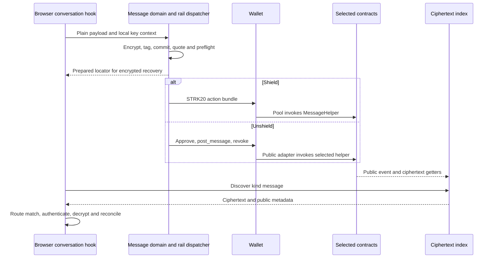
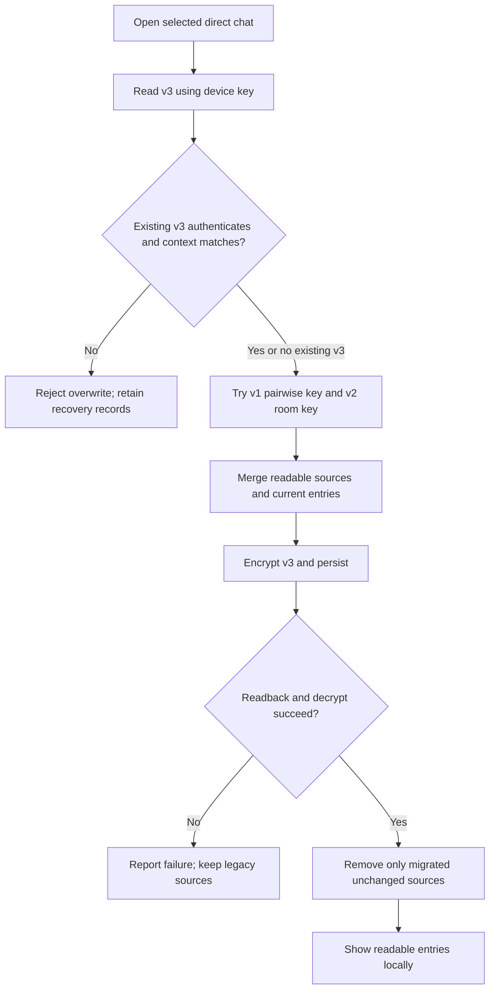

# VINSS Starknet Messaging — Code Audit and Security Boundaries

> Refreshed 31 October 2026 from branch `feat/strk20-unshield-fees`, source baseline `d3daf1e` (includes cache v3 and mobile layout). **This is an implementation audit, not a new messaging protocol and not live-chain proof.** This is the pre-MLS baseline. New direct text now uses [OpenMLS inside this transport](./openmls-starknet.md); the findings and diagrams below describe the outer envelope and legacy/separate workflows.

## 1. Architectural thesis

VINSS combines private *commercial coordination* with public verifiable settlement. Messages, offers and negotiation content require confidentiality; settlement and encrypted-action persistence require chain-backed evidence. These are distinct properties, not equivalent to full anonymity.

- **Client:** owns plaintext, encryption/decryption, per-room messaging identity, and secret routing contexts.
- **Wallet / execution rail:** Shield authorizes native bundles via `WalletAccountV6.strk20InvokeTransaction`; Unshield authorizes public adapter multicalls via `account.execute`; it is not responsible for encrypting the app's JSON automatically.
- **Cairo MessageHelper:** validates structural V2 ciphertext envelopes, Poseidon commitment, replay/locator guards and FeePolicy minimum; stores ciphertext chunks and emits a public commitment event.
- **Backend indexer:** follows public events, reads on-chain ciphertext into PostgreSQL, and serves candidates by `POST /discover` without app decryption keys.
- **Receiving browser:** validates routing tags, decrypts ciphertext locally, filters direct-peer/group scope and reconciles pending state.

The audited baseline application cryptography is **WebCrypto AES-GCM + HMAC-SHA-256 + P-256 ECDH/HKDF**. These primitives remain the outer transport. The later direct-text OpenMLS integration has its own linked code map and evidence.

## 2. Source-of-truth map

| Concern | Audited code |
|---|---|
| Encrypt/decrypt and packing | `frontend/lib/privacy/envelope.ts` |
| Direct identity and pairwise keys | `frontend/lib/privacy/participantKeys.ts` |
| Room/group secret derivation | `frontend/lib/privacy/channelKey.ts` |
| V2 tags and Poseidon commitment | `frontend/lib/privacy/messageRouting.ts` |
| Wallet send and local discovery | `frontend/lib/deal-room/messaging.ts` |
| Direct send, encrypted history, pending reconciliation | `frontend/hooks/room/useDirectConversation.ts` |
| Group send/discovery | `frontend/hooks/room/useGroupConversation.ts` |
| Direct-history storage and migration | `frontend/lib/privacy/deviceHistory.ts` (`readDirectHistory`, `writeDirectHistory`) |
| AES-GCM local record primitive | `frontend/lib/privacy/encryptedChatCache.ts` (raw key or CryptoKey) |
| Mode/transport/execution | `frontend/app/room/[roomId]/page.tsx`, `frontend/lib/deal-room/messageGateway.ts`, `frontend/lib/starknet/vinssExecution.ts`, `frontend/lib/starknet/publicRailCalls.ts` |
| Presentation scroll | `frontend/hooks/room/useConversationScroll.ts`, `frontend/lib/ui/conversationScroll.ts`, Direct/Group panels and `frontend/app/globals.css` |
| Encrypted attachment upload | `frontend/lib/privacy/directAttachments.ts` |
| Message Cairo storage/authorization | `contracts/src/messaging/vinss_message_helper.cairo` |
| Contract format/limits | `contracts/src/messaging/messaging_validation.cairo` and `contracts/src/utils/constants.cairo` |
| Event scan and ciphertext hydration | `backend/src/indexer/poolEvents.ts`, `definitions.ts`, `service.ts`, `store.ts` |
| Read-only discovery API | `backend/src/routes/discover.ts` |

## 3. Key hierarchy and participant trust

**Room:** `generateRoomSecret()` produces a browser-local random secret; `deriveChannelKeyFromRoomSecret` hashes a domain-separated input (`VINSS_ROOM_KEY_V1`). Room secrets are *currently stored plaintext in localStorage*; they should be treated as sensitive bearer-like access material.

**Direct:** for each room and wallet, `participantKeys.ts` generates/restores a P-256 ECDH identity in IndexedDB. It stores a **non-exportable private CryptoKey** and exports only the public key. Alice and Bob use P-256 ECDH and **HKDF-SHA-256**, salted with SHA-256 of the room ID and info `VINSS_DIRECT_MESSAGE_KEY_V1`, to derive a 32-byte pairwise message key. Group members with only a room secret cannot reconstruct the direct pairwise key. However, the peer public key's provenance matters: possession of a key is not independently proof of which wallet/person owns it. Do not claim authenticated identity enrollment without verifying its binding steps.

**Group:** `deriveGroupKeyFromSecret` uses a *different* domain (group vs room) and supplies `sendMessage` with a group key. Group ID and scope are inside ciphertext, not on the public helper record. Group key sharing/membership is **not** MLS epoch ratcheting or post-compromise recovery.

**Viewing key distinction:** `deriveChannelKeyViaEcdh` is a scaffolded STRK20 viewing-key proposal, explicitly **not** the active UI path. Wallet view keys, Cairo account signing keys, room secrets, and VINSS P-256 message identities are four different trust boundaries.

## 4. Exact Message V2 wire model

Client constructs `message_locator` from cryptographic randomness and an app channel key. HMAC-SHA-256 tags depend on the routing key, role, canonicalized identity and **this locator**, so tags are per action rather than stable public chat IDs.

| Calldata index | Value | Exposure |
|---|---|---|
| 0 | `envelope_version = 2` | public |
| 1 | `message_locator` | public one-time locator |
| 2 | `sender_tag` | public opaque HMAC tag |
| 3 | `recipient_tag` | public opaque HMAC tag |
| 4 | `claimed_payload_commitment` | public Poseidon hash |
| 5 | `payload_chunk_count` | public; Cairo requires 1–64 |
| 6 onward | `ciphertext_chunks` | **public ciphertext** in contract storage |
| last minus one | `quoted_fee` | public/transaction revenue amount |
| last | `open_note_id` | wallet-managed placeholder, not invented by VINSS |

Domain-separated commitment:
`Poseidon('VINSS_MSG_COMMIT_V2', 2, locator, sender_tag, recipient_tag, chunk_count, ...ciphertext_chunks)`.

`VinssMessageHelper.privacy_invoke` accepts calls **only from its configured authorized execution address**: the native helper is pinned to the Privacy Pool; the dedicated public helper is pinned to its public adapter. Both deployments retain the same encrypted envelope checks. It checks exact length, version, nonzero locator/tags/commitment, valid chunk count, Poseidon equality and no duplicate locator/commitment before writing storage and emitting `MessageCommitted`. The contract **does not know the plaintext, real peer addresses, message kind or conversation ID**, and the Poseidon hash is not a signature proving real-world authorship. Its public event contains locator, commitment and tags, **not the whole ciphertext**. Ciphertext chunks are separately retrievable on-chain.

## 5. Payment logic: service fee vs STRK20 fee

`sendMessage` builds one wallet-authorized STRK20 bundle:
1. `withdraw` currently quoted revenue token amount to MessageHelper.
2. `transfer` the wallet's `OPEN` note output to VINSS treasury.
3. `invoke` the MessageHelper using a count-prefixed private calldata and wallet-managed OpenNote ID.
4. Optional additional privacy invokes, if explicitly requested by the calling workflow.

`quoteMessageFee()` resolves `MessageHelper.get_fee_policy()` then queries `FeePolicy.quote_fee(2)`. Cairo requires `quoted_fee >= minimum_fee`. App-fee v2 targets Message **$0.02 Shield / $0.01 Unshield**, Offer and activation **$0.10 Shield / $0.05 Unshield**. These are USD policy targets, not hardcoded STRK amounts. The active helper-linked oracle quote is authoritative. V2 flat app pricing removes the old sponsor floor; infrastructure pool/wallet/relayer charges remain separate and Rekber economics are unchanged. See [app-fee v2](../smart-contracts/app-fee-v2.md).

Distinguish **principal** moved in a transaction, **VINSS app revenue**, and **STRK20/wallet/network fees**. For plain Shield/Unshield routes VINSS adds **no** service-fee transfer. The protocol fee is not controlled by VINSS; a transaction receipt's `actual_fee` is not itself the total STRK20 cost.

## 6. Send, discover, decrypt and recover

`sendMessage` first resolves encryption/routing keys, encrypts JSON payload with AES-GCM (fresh 12-byte IV), computes ephemeral tags and commitment, fetches the live fee, and builds wallet actions. Only after preflight succeeds does it call `onPrepared(locator, commitment)`. The UI may persist an *encrypted pending body* and show an optimistic bubble. Wallet callback/hash is **submitted**, not chain-confirmed.

Backend scans `MessageCommitted` via `starknet_getEvents` with pagination and block checkpoints. Definitions can include active, historical and opposite-mode helper addresses using `ADDITIONAL_DISCOVERY_HELPERS`; checkpoints/storage identity include network, kind and helper contract. `/discover` combines configured helpers of the requested kind, allowing same-room mode changes to retain indexed encrypted history without sending a room identifier to the server. For each locator it reads `get_message` and `get_payload_chunk`, indexing ciphertext in PostgreSQL. It exposes:

~~~http
POST /discover
Content-Type: application/json

{"kind":"message"}
~~~

The endpoint accepts only `kind`, optional `fromBlock` and `toBlock`; room secrets, viewing keys, channel keys and plaintext are refused. It supplies *candidate ciphertext*, not a server-authorized decrypted inbox.

Receiver checks expected recipient HMAC tag before decrypting, then verifies sender tag against sender identity in decrypted payload when present, then the direct hook filters selected sender/recipient, or the group hook filters encrypted `groupId`. Secret app keys do **not** need to travel to backend. AES-GCM rejects tampered content when the bytes/key are correct.

Direct state is approximately:
`Draft → Prepared/optimistic → Submitted or wallet-ambiguous → Indexed by exact locator → Locally decrypted and reconciled`.

A mobile wallet timeout **after** preparation is ambiguous; direct hook retains the pending record and rechecks the exact locator rather than blindly resubmitting. Direct history v3 is encrypted in localStorage with an independent non-exportable IndexedDB device key; pending records remain pairwise-key encrypted. Group pending storage uses **locator/timing metadata** rather than a plaintext draft and has different recovery semantics—do not claim direct/group recovery equivalence.

## 7. Storage boundaries and data minimization

| Data | Storage / visibility | Important caveat |
|---|---|---|
| Message body, direct peer metadata, group ID, attachment reference | AES-GCM encrypted JSON; ciphertext on-chain | Contract integrity != peer identity proof |
| Direct ECDH private key | IndexedDB non-exportable WebCrypto key | Compromised browser or lost device remains a risk |
| Direct history v3 | AES-GCM localStorage + non-exportable AES key in IndexedDB | Room secret cannot decrypt migrated v3; device key required |
| Direct pending | Pairwise-key encrypted localStorage | Correct pairwise identity/key required |
| Room/group secret | **Plaintext localStorage** | Local capability exposure |
| Cached peer public key/address | Plaintext localStorage | Relationship metadata visible on device |
| Message event/locator/tag/commitment, tx/block timing | Public Starknet metadata | Correlation possible |
| Attachment file | Encrypted client-side then held as **off-chain ciphertext** by backend | File bytes are not on-chain; 20 MiB input limit |
| Agent/Feedback/Dispute evidence | Separate explicit API flows | Blanket "backend never gets plaintext" claim is false outside normal discovery |

Routing hides reusable *application* identifiers from ordinary helper storage, but not every traffic relationship, transaction amount, fee, time, or counterparty signal.

## 8. Audit findings and remediation status (updated 31 October 2026)

### P1: historic lossy felt packing — fixed in source, chain regression pending

Before `fab9b65`, `envelope.ts` encoded 30-byte slices as bare bigints, discarding leading zero bytes. For example `[0x00,0x01,0x02] → 0x0102 → [0x01,0x02]`.

**Current source:** `frontend/lib/privacy/feltCodec.ts` uses a versioned **inner codec marker**, explicit byte length and a sentinel per packed 30-byte chunk, preserving zero-leading and all-zero chunks. Legacy encrypted records have no version/length; the decoder restores every full 30-byte chunk and considers at most 30 final-block lengths. `decryptPayload()` selects a legacy candidate **only if AES-GCM authentication succeeds**. The Cairo **outer Message V2 header, commitment, fee quote and contract ABI remain unchanged**.

[Unit tests](https://github.com/DXJLabs/vinss/blob/feat/strk20-unshield-fees/tests/messaging-codec-transport.test.mjs) exercise leading-zero, all-zero, chunk-boundary and legacy-authentication vectors. **Still needed:** real previously indexed on-chain ciphertext samples, two-wallet Alice/Bob browser E2E, and old/new Offer/Private Escrow cross-compatibility validation.

### P1: wallet error diagnostics — sanitized for Message submission

Previously `messaging.ts` logged raw wallet error metadata, `debugActions` and JSON-serialized exceptions. The Message exception path now emits only a static failure class (`WALLET_DECLINED` or `WALLET_OUTCOME_UNKNOWN`) with generic user-facing text. It **does not print or rethrow raw wallet exceptions/ciphertext**. The existing direct-chat pending recovery still reconciles a prepared action by locator rather than treating an ambiguous callback as a failed transaction.

**Still needed:** audit other domain modules, wallet extensions and telemetry. `discoverMessages()` does not contain the older alleged decrypted-body console log.

### Multichain gateway — Starknet first, fail-closed

[Multichain Messaging Transport](./multichain-messaging.md) introduces chain-qualified message delivery, but **both Starknet STRK20 and public Unshield rails are registered**. Canton/EVM connectors, identity bindings and cross-chain receipt correlation remain future integrations.

### P2: remaining privacy and operational work

- Authenticate peer public-key enrollment and restore/migration provenance.
- Guard local plaintext room/group capabilities against XSS, extensions, device sharing and unsafe backup.
- Load-test event scan, per-chunk RPC reads, initial indexer catch-up and candidate discovery scaling.
- Validate cross-device recovery and rekey/membership changes; not an MLS implementation.
- Avoid claims of zero metadata, anonymity, all-plaintext-free backend, or universal wallet compatibility.

## 9. Verification matrix and promotion criteria

| Test | Required evidence |
|---|---|
| Crypto | Round-trip full arbitrary byte sequences, including leading zero and all-zero chunks; AES-GCM decrypt succeeds |
| Cairo compatibility | V2 domain, Poseidon vector, six-field header, 64-chunk limit, duplicate rejection |
| Direct Alice/Bob | Verified wallet identity/key exchange, send, accepted tx, indexed ciphertext, other peer decrypt |
| Recovery | Hard refresh, wallet timeout/rejection ambiguity, exact locator lookup, dedupe |
| Group | Group-key isolation, no plaintext groupId in helper event, member change handling |
| Security | Wrong key, forged tag, malformed calldata, bad fee, browser diagnostics leaks |
| Fees | Helper-linked *active* FeePolicy quote, wallet STRK20 quote and gas all recorded distinctly |
| Deployment | Explicit chain, wallet version, contract addresses, tx hashes, receipts and observed outcomes |

**Evidence at audit:** CI [39812347541](https://github.com/DXJLabs/vinss/actions/runs/39812347541) passed frontend build and Cairo regressions on this branch; this **does not constitute messaging browser E2E, proof that the codec is sound, or Sepolia Shield/Unshield transaction verification**.

## 10. Related documents

[Direct two-party chat](./direct-chat.md) · [Privacy model](./privacy-model.md) · [Wallet and STRK20](./wallet-strk20.md) · [Shield/Unshield](./shield-unshield.md) · [MessageHelper Cairo](../smart-contracts/message-helper.md) · [Discovery/indexer](../backend/discovery-indexer.md).

**Historical OpenMLS recommendation, superseded for direct text by the linked integration:** design authenticated group membership/epochs, key-package provisioning, device restore and backward-compatible V2 migration explicitly. STRK20 remains the Shield transaction mechanism; Unshield uses the public adapter. MLS should not be described as already active.

## 11. Updated execution and plaintext boundary

The room page derives one mode-scoped account with `accountForMode`. `useRoomConversation` delegates direct/group messaging to the active hooks; `useRoomOffers` receives the same scoped session. There is no second Offer toggle or separate default that should silently override the room mode.

`messageGateway.ts` chooses a registered transport, while `messaging.ts` performs app encryption before either rail executes. `publicRailCalls.ts` translates the encrypted intent into an ordinary public multicall, replacing the OpenNote placeholder with an adapter sentinel and appending the actor-bound nonce. It does not copy the plaintext body into public calldata. Unshield reveals wallet/token execution metadata, not the encrypted business terms.

The six-field Message V2 header and ciphertext commitment remain unchanged. On normal discovery the server accepts only kind/block filters and returns ciphertext plus public metadata. `discoverMessages` decrypts in the browser, then returns a local object that associates the readable message with locator/hash/block. That local association is the only intended combination of readable content with chain evidence; it does not upload the plaintext to discovery.

## 12. Device history v3: key boundary and migration

The previous room-key direct-history weakness is fixed **for v3 records written/migrated by the current client**. `deviceHistory.ts` generates a random 256-bit AES key and atomically restores/inserts its non-exportable CryptoKey in IndexedDB `vinss-device-history/keys`. This is a separate database and key from the P-256 messaging identity. LocalStorage keeps only the v3 encrypted value plus public namespace metadata.

Each v3 clear record is `{version:1,savedAt,context,entries}` before encryption. The context is room/self/peer, checked after authenticated decrypt. Reads refuse corrupt or wrong-context v3 instead of substituting empty history. Writes merge by locator and preserve readAt. A module queue serializes operations for the same cache, with Web Locks for cooperating tabs when available.

Migration reads v1 with a usable pairwise key and v2 with the room key. It encrypts the merged result to v3, verifies that localStorage contains the expected serialized record, authenticates/decrypts it, then removes only successfully migrated unchanged source copies. Wrong legacy keys keep their ciphertext for later retry. Quota/IndexedDB errors do not fall back to room-key encryption or plaintext.

Migration is per conversation, not a bulk erasure of unopened legacy caches. A previously copied vulnerable v2 record cannot be made private retroactively. Room/group secrets, Offer-history and Rekber-secret stores retain their separate existing threat models. Same-origin malicious scripts and full browser-profile compromise can still access usable keys or open messages. No new cross-device restore exists: losing IndexedDB can prevent v3 recovery; losing the separate P-256 identity can also prevent historical network-message decrypt.

## 13. Presentation and practical evidence

`useConversationScroll` owns following/jump intent for the Direct and Group panels. Data polling hooks no longer call `scrollIntoView`. Below 1024px the message list follows normal page flow; desktop uses a bounded internal scroller. User navigation pauses automatic following so a new entry does not force a reader back down. This does not change encryption, keys, mode selection or confirmation rules.

Runtime evidence resides in:

- `frontend/tests/message-privacy-boundary.test.ts`: actual encryption/decrypt, wrong keys/tampering, discovery request payload and local plaintext association.
- `frontend/tests/device-history.test.ts`: CryptoKey non-exportability, safe v1/v2 migration, quota failure, corrupt-target preservation, context/account isolation and concurrent writes.
- `frontend/tests/public-rail-runtime.test.ts`: real domain encryption and mode dispatcher against wallet/RPC fixtures; Offer lifecycle tested in both rails with pairwise terms.
- `frontend/tests/conversation-scroll.test.ts`: page versus internal scroll metrics and desktop scroll target.
- `tests/messaging-codec-transport.test.mjs`: lossless felt packing and authenticated legacy recovery.

These tests establish source behavior at controlled boundaries. They are not a new claim of live two-wallet Offer execution or complete browser/Android gesture verification. The scoped [31 October privacy audit](./message-privacy-audit-2026-10-31.md) records live discovery schema observations and their limits; [device history](./device-history.md) records recovery limits.

## Escrow Rekber handoff

Message and Offer are coordination surfaces for the same **Escrow Rekber** product. An authenticated accepted Offer opens the actual agreement/funding/protection UI; it does not itself move principal. The [Escrow Rekber lifecycle and code map](./escrow-rekber.md) documents the two contract layers, fixed roles, original Shield/Unshield binding and canonical settlement authority.
